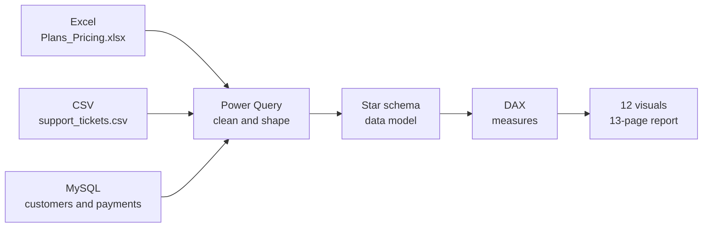
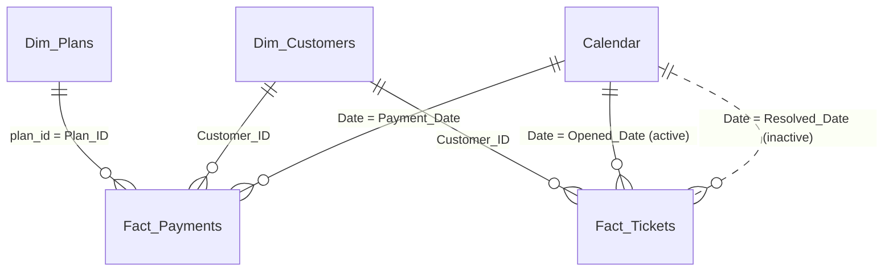
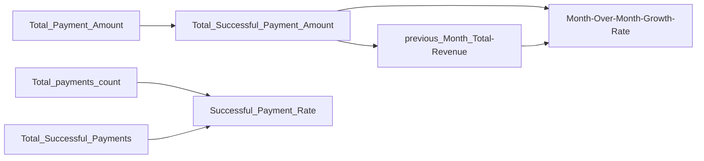
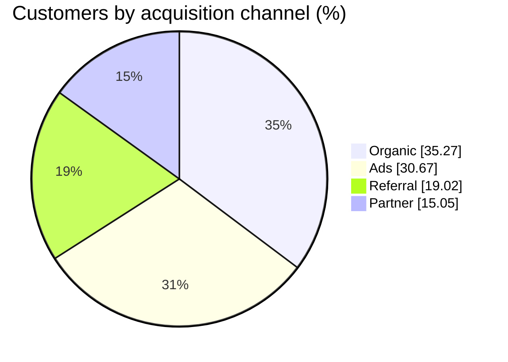
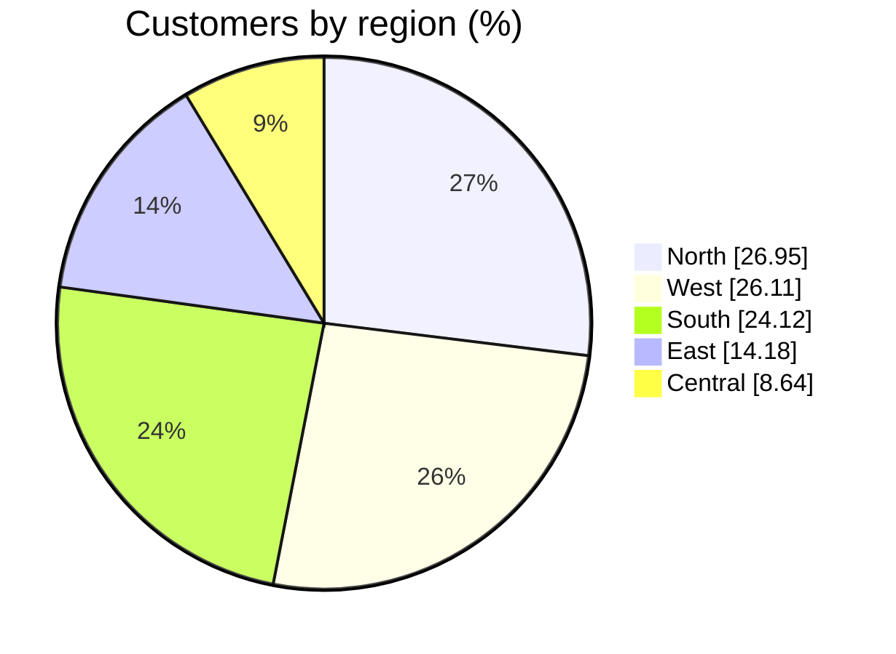
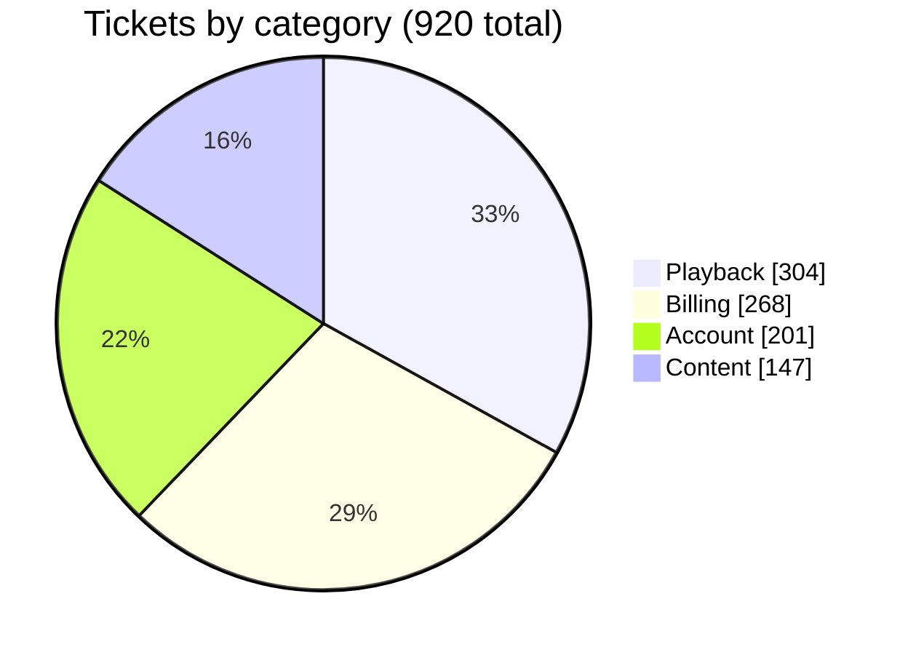

<a id="top"></a>

# StreamPlus Subscription Analytics

**An end-to-end Power BI project analysing revenue, customers, payments and customer support for a video-streaming subscription business.**


| [1. Overview](#overview) | [2. Data](#data) | [3. Data Transformation](#transformation) | [4. Data Modelling and Analysis](#modelling) | [5. How to Run](#run) |
|:---:|:---:|:---:|:---:|:---:|

---

<a id="overview"></a>

## 1. Project Overview

### Background

StreamPlus is a video-streaming service that sells four subscription plans: **Mobile, Basic, Standard and Premium**. Management needs to know where revenue comes from, which customers and acquisition channels matter most, how reliable payments are, and how well the support team performs.

This project answers **12 strategic questions** in three themes. Each question is answered by one DAX-driven visual in a 13-page Power BI report.

### Project at a glance

| Item | Detail |
|---|---|
| Period covered | January 2024 to September 2026 |
| Data sources | Excel workbook, CSV file, MySQL database (created by an SQL script) |
| Tables in the model | 6: 2 dimensions, 2 facts, 1 calendar, 1 measures table |
| Data volume | about 4.9K customers, about 40.4K payments, 920 support tickets, 4 plans |
| DAX | 1 calculated table, 9 calendar columns, 1 ticket calculated column, 14 measures |
| Business questions | 12 |
| Report pages | 13 (pages 3 to 13 each answer a question) |

### Workflow



### The 12 questions

| Theme | # | Question | Visual | Jump to |
|---|:-:|---|---|---|
| **Customer and Revenue** | 1 | Plan revenue growth over time | Line chart | [Q1](#q1) |
| | 2 | Acquisition channel efficiency | Donut chart | [Q2](#q2) |
| | 3 | Regional customer distribution | Matrix | [Q3](#q3) |
| | 4 | High-value customers | Table | [Q4](#q4) |
| **Support and Satisfaction** | 5 | Overall support performance | Card | [Q5](#q5) |
| | 6 | Support workload by category | Treemap | [Q6](#q6) |
| | 7 | Resolution speed analysis | Scatter plot | [Q7](#q7) |
| | 8 | Urgent ticket monitoring | KPI card | [Q8](#q8) |
| **Advanced Business Logic** | 9 | Payment success rate | Gauge | [Q9](#q9) |
| | 10 | Popularity of streaming quality tiers | Clustered column | [Q10](#q10) |
| | 11 | Month-over-month revenue growth | Waterfall | [Q11](#q11) |
| | 12 | Support ticket seasonality | Area chart | [Q12](#q12) |

### Repository structure

```text
streamplus-project/
|-- ER-Diagram/
|   `-- ER-Diagram.png               ER diagram of the MySQL database
|-- Images/                          Data model and dashboard screenshots
|-- Queries/
|   `-- streamplus_mysql_lite.sql    Creates the schema, tables and sample rows
|-- Raw-Data/
|   |-- Plans_Pricing.xlsx           Plans source file
|   `-- support_tickets.csv          Support tickets source file
|-- Report/
|   `-- StreamPlus_Project.pbix      Power BI report
`-- README.md
```

[Back to top](#top)

---

<a id="data"></a>

## 2. Data

### Source summary

| Table | Type | Source | Location | Rows | Role in the questions |
|---|---|---|---|---:|---|
| `Dim_Plans` | Dimension | Excel | `Raw-Data/Plans_Pricing.xlsx` | 4 | Plan names, quality tier and prices (Q10) |
| `Dim_Customers` | Dimension | MySQL | `Queries/streamplus_mysql_lite.sql` | about 4.9K | Region, city and acquisition channel (Q2, Q3, Q4, Q10) |
| `Fact_Payments` | Fact | MySQL | `Queries/streamplus_mysql_lite.sql` | about 40.4K | Amount, status, method and attempt for every payment (Q1, Q4, Q9, Q10, Q11) |
| `Fact_Table(support_tickets)` | Fact | CSV | `Raw-Data/support_tickets.csv` | 920 | Category, priority, status and CSAT of every ticket (Q5, Q6, Q7, Q8, Q12) |
| `Calendar` | Date dimension | DAX | Inside the `.pbix` file | 1,096 | Time axis for revenue, growth and ticket trends (Q1, Q11, Q12) |
| `_Measures` | Measures holder | Enter Data | Inside the `.pbix` file | none | Stores the 14 DAX measures |

### How the data is fetched

<!-- VERIFY: connector used for Dim_Customers and Fact_Payments (MySQL database or exported files) -->

| Source | How it reaches Power BI |
|---|---|
| Plans | Loaded from the Excel workbook. The sheet is laid out sideways, so it is transposed in Power Query. |
| Tickets | Loaded from the CSV file. |
| Customers and payments | `streamplus_mysql_lite.sql` is run in MySQL Workbench to create the schema, tables and rows. Power BI then loads the tables. |
| Calendar | Generated inside Power BI with DAX, covering 01-01-2024 to 31-12-2026. |

### Column dictionary

<details>
<summary><b>Dim_Plans</b> (4 rows, one per plan)</summary>

<br>

| Column | Description |
|---|---|
| `plan_id` | Plan key (1 to 4) |
| `Plan_Name` | Mobile, Basic, Standard or Premium |
| `max_screens` | Number of simultaneous screens |
| `video_quality` | Streaming definition: 480p, 720p, 1080p or 4K |
| `price_2024`, `price_2025`, `price_2026` | Plan price for each year |

| plan_id | Plan_Name | max_screens | video_quality | Price (2024 and 2025) |
|:-:|---|:-:|:-:|---:|
| 1 | Mobile | 1 | 480p | 149 |
| 2 | Basic | 2 | 720p | 249 |
| 3 | Standard | 2 | 1080p | 499 |
| 4 | Premium | 4 | 4K | 799 |

</details>

<details>
<summary><b>Dim_Customers</b> (one row per customer)</summary>

<br>

| Column | Description |
|---|---|
| `Customer_ID` | Customer key |
| `Customer_Name` | Customer name. Names repeat, so always use `Customer_ID` to identify a customer. |
| `City` | One of 20 Indian cities |
| `Region` | North, South, East, West or Central |
| `Signup_Date` | Date the customer signed up |
| `Acquisition_Channel` | Organic, Ads, Referral or Partner |

</details>

<details>
<summary><b>Fact_Payments</b> (one row per payment)</summary>

<br>

| Column | Description |
|---|---|
| `Payment_ID` | Payment key |
| `Customer_ID` | Links to `Dim_Customers` |
| `Plan_ID` | Links to `Dim_Plans` |
| `Payment_Date` | Date of payment, links to `Calendar` |
| `Amount` | Amount paid |
| `Status` | Outcome of the payment, for example Success |
| `Attempt_No` | Attempt number for the payment (1 or 2) |
| `Payment_Method` | Method used to pay |

</details>

<details>
<summary><b>Fact_Table(support_tickets)</b> (one row per ticket)</summary>

<br>

| Column | Description |
|---|---|
| `Ticket_ID` | Ticket key |
| `Customer_ID` | Links to `Dim_Customers` |
| `Opened_Date` | Date the ticket was opened, links to `Calendar` |
| `Category` | Playback, Billing, Account or Content |
| `Priority` | High, Medium or Low |
| `Status` | Open or Resolved |
| `Resolved_Date` | Date the ticket was resolved (blank while open) |
| `Csat_Score` | Customer satisfaction score given after resolution |
| `Resolution_time` | Calculated column: days from opened to resolved date |

</details>

<details>
<summary><b>Calendar</b> (1,096 rows, 2024 to 2026)</summary>

<br>

| Column | Example | Purpose |
|---|---|---|
| `Date` | 01-01-2024 | Key used in relationships |
| `Day`, `MonthNumber`, `MonthName`, `Year`, `Quarter` | 1, 1, January, 2024, Q1 | Basic date parts |
| `Month-Year` | Jan 2024 | Monthly chart axis |
| `Quarter-Year` | 2024Q1 | Quarterly chart axis |
| `MonthYearSort`, `QuarterYearsort` | 202401 | Sort keys so periods appear in time order |

</details>

[Back to top](#top)

---

<a id="transformation"></a>

## 3. Data Transformation

All cleaning is done in **Power Query**, so the source files and the database stay untouched.

### Rules applied across the tables

| Rule | Applied to |
|---|---|
| Consistent `Proper_Case` column names | All tables |
| Text trimmed and capitalised | Customers, tickets |
| Correct data types (whole number, text, date) | All tables |
| Duplicate records removed | Tickets |
| Unusable rows filtered out | Customers, tickets |

### Steps by table

<details>
<summary><b>Dim_Plans</b> (Excel)</summary>

<br>

| Step | Purpose |
|---|---|
| Source, Navigation | Connect to the workbook and select the sheet |
| Promoted Headers, Changed Type | Set headers and types |
| Removed unwanted data | Drop leftover rows and columns |
| **Transposed rows and columns** | The sheet had plans as columns; the model needs one row per plan |
| Used first row as headers | Restore proper column names after the transpose |
| Changed price type to whole number | Prices have no decimals |
| Moved `plan_id` to the first column | Key column first |
| Renamed `Attribute` to `Plan_Name` | Readable name |

</details>

<details>
<summary><b>Dim_Customers</b> (MySQL)</summary>

<br>

| Step | Purpose |
|---|---|
| Promoted Headers, Changed Type, Renamed Columns | Standard headers, types and names |
| **Trimmed Text** | Remove stray spaces |
| **Capitalized Each Word** | Consistent names and cities |
| **Filtered Rows** | Remove rows where `Customer_Name` is null or empty |

```m
= Table.SelectRows(#"Filtered Rows", each [Customer_Name] <> null and [Customer_Name] <> "")
```

</details>

<details>
<summary><b>Fact_Payments</b> (MySQL)</summary>

<br>

| Step | Purpose |
|---|---|
| Promoted Headers, Changed Type | Headers and data types |
| **Renamed Columns** | Match the naming standard of the other tables |

```m
= Table.RenameColumns(#"Changed Type", {{"payment_id", "Payment_ID"}, {"customer_id", "Customer_ID"}, {"plan_id", "Plan_ID"}, ...})
```

</details>

<details>
<summary><b>Fact_Table(support_tickets)</b> (CSV)</summary>

<br>

| Step | Purpose |
|---|---|
| Promoted Headers, Changed Type | Headers and data types |
| **Removed Duplicates** (twice) | Keep one row per ticket |
| **Priority standardised** | Trimmed, capitalised and restricted to High, Medium, Low |
| **Category standardised** | Trimmed and capitalised each word |
| **Date columns converted** | `Opened_Date` and `Resolved_Date` set to the Date type |
| Filtered Rows (twice) | Remove invalid records |
| **Renamed Columns** | Consistent names |

```m
= Table.RenameColumns(#"Removed Duplicates1", {{"Score", "Csat_Score"}, {"Resolved_date", "Resolved_Date"}, {"Opened_date", "Opened_Date"}})
```

</details>

<details>
<summary><b>_Measures</b> and <b>Calendar</b></summary>

<br>

| Table | Approach |
|---|---|
| `_Measures` | A placeholder table created with Enter Data. Its dummy column was removed in Power Query, so the table only holds measures. |
| `Calendar` | Created with DAX in the model, not in Power Query. See [section 4.4](#dax). |

</details>

[Back to top](#top)

---

<a id="modelling"></a>

## 4. Data Modelling and Analysis

This section shows the data model, every DAX formula, and how each of the 12 questions was answered, with the visual and its result.

### 4.1 Data model




`Fact_Tickets` in the diagram is the table `Fact_Table(support_tickets)` in the report. The original MySQL design is in [`ER-Diagram/`](ER-Diagram/).

| Property | Value |
|---|---|
| Schema type | Star schema |
| Fact tables | `Fact_Payments`, `Fact_Table(support_tickets)` |
| Dimension tables | `Dim_Plans`, `Dim_Customers`, `Calendar` |
| Relationships | 6 (5 active, 1 inactive) |
| Cardinality | One-to-many on every relationship |
| Filter direction | Single, from dimension to fact |

### 4.2 Relationships

| # | One side | Many side | Cardinality | Filter direction | Status | Purpose |
|:-:|---|---|:-:|---|---|---|
| 1 | `Dim_Plans[plan_id]` | `Fact_Payments[Plan_ID]` | 1 : * | Single | Active | Revenue and customers by plan |
| 2 | `Dim_Customers[Customer_ID]` | `Fact_Payments[Customer_ID]` | 1 : * | Single | Active | Revenue by customer, channel, region |
| 3 | `Dim_Customers[Customer_ID]` | `Fact_Table(support_tickets)[Customer_ID]` | 1 : * | Single | Active | Tickets by customer |
| 4 | `Calendar[Date]` | `Fact_Payments[Payment_Date]` | 1 : * | Single | Active | Revenue over time |
| 5 | `Calendar[Date]` | `Fact_Table(support_tickets)[Opened_Date]` | 1 : * | Single | Active | Ticket volume over time |
| 6 | `Calendar[Date]` | `Fact_Table(support_tickets)[Resolved_Date]` | 1 : * | Single | Inactive | Role-playing date, switched on with `USERELATIONSHIP` |

### 4.3 Modelling decisions and filters

| Decision | Reason |
|---|---|
| Star schema | Facts hold events, dimensions hold attributes. DAX stays simple and filters stay predictable. |
| Single-direction, one-to-many relationships | Avoids ambiguous filter paths. |
| One `Calendar` for both facts | Revenue and tickets share the same time axis. |
| Inactive `Resolved_Date` relationship | A fact table can have only one active relationship to a date table. |
| No direct link between payments and tickets | They meet only through `Dim_Customers` and `Calendar`. |
| Measures in `_Measures` | All calculations live in one place. |

| Filter layer | Filter | Used for |
|---|---|---|
| Power Query | Null or empty `Customer_Name` removed | Clean customer list |
| Power Query | Duplicates removed, invalid rows filtered | One row per ticket |
| Model | Single-direction cross-filtering | Predictable results |
| DAX | `Status = "Success"` | Successful payments (Q9, Q11) |
| DAX | `Priority = "High"` and `Status = "Open"` | Urgent tickets (Q8) |
| DAX | `DATEADD(..., -1, MONTH)` | Previous-month revenue (Q11) |
| Visual | Sorted by revenue, descending | Top customers (Q4) |

<a id="dax"></a>

### 4.4 DAX

<!-- VERIFY: compare each formula below with the formulas in the .pbix and replace any that differ -->

#### How the measures connect



<details>
<summary><b>Calendar table and calculated columns</b></summary>

<br>

```dax
Calendar = CALENDAR ( DATE ( 2024, 1, 1 ), DATE ( 2026, 12, 31 ) )

Day              = DAY ( Calendar[Date] )
MonthNumber      = MONTH ( Calendar[Date] )
MonthName        = FORMAT ( Calendar[Date], "MMMM" )
Year             = YEAR ( Calendar[Date] )
Quarter          = "Q" & QUARTER ( Calendar[Date] )
Quarter-Year     = YEAR ( Calendar[Date] ) & "Q" & QUARTER ( Calendar[Date] )
QuarterYearsort  = YEAR ( Calendar[Date] ) * 100 + QUARTER ( Calendar[Date] )
Month-Year       = FORMAT ( Calendar[Date], "MMM YYYY" )
MonthYearSort    = YEAR ( Calendar[Date] ) * 100 + MONTH ( Calendar[Date] )
```

`Month-Year` is sorted by `MonthYearSort`, and `Quarter-Year` by `QuarterYearsort`.

</details>

<details>
<summary><b>Calculated column: Resolution_time</b> (Q7)</summary>

<br>

```dax
Resolution_time =
DATEDIFF (
    'Fact_Table(support_tickets)'[Opened_Date],
    'Fact_Table(support_tickets)'[Resolved_Date],
    DAY
)
```

Days between opening and resolving a ticket. Open tickets have no resolved date, so they stay blank.

</details>

<details open>
<summary><b>Revenue and payment measures</b> (Q1, Q4, Q9, Q11)</summary>

<br>

```dax
Total_Payment_Amount =
SUM ( Fact_Payments[Amount] )

Total_Successful_Payment_Amount =
CALCULATE ( [Total_Payment_Amount], Fact_Payments[Status] = "Success" )

Total_payments_count =
COUNTROWS ( Fact_Payments )

Total_Successful_Payments =
CALCULATE ( COUNTROWS ( Fact_Payments ), Fact_Payments[Status] = "Success" )

Successful_Payment_Rate =
DIVIDE ( [Total_Successful_Payments], [Total_payments_count] )

Payment_Method_Count =
COUNT ( Fact_Payments[Payment_Method] )

Payment_Status_Count =
COUNT ( Fact_Payments[Status] )
```

| Measure | What it returns |
|---|---|
| `Total_Payment_Amount` | Sum of all payment amounts |
| `Total_Successful_Payment_Amount` | Sum of amounts where the payment succeeded |
| `Total_payments_count` | Number of payment records |
| `Total_Successful_Payments` | Number of successful payments |
| `Successful_Payment_Rate` | Successful payments divided by all payments. `DIVIDE` avoids division errors. |
| `Payment_Method_Count`, `Payment_Status_Count` | Supporting counts used with method or status on an axis |

</details>

<details open>
<summary><b>Time-intelligence measures</b> (Q11)</summary>

<br>

```dax
previous_Month_Total-Revenue =
CALCULATE ( [Total_Successful_Payment_Amount], DATEADD ( Calendar[Date], -1, MONTH ) )

Month-Over-Month-Growth-Rate =
DIVIDE (
    [Total_Successful_Payment_Amount] - [previous_Month_Total-Revenue],
    [previous_Month_Total-Revenue]
)
```

`DATEADD` shifts the date filter back one month, so each month can be compared with the one before it.

</details>

<details open>
<summary><b>Customer and support measures</b> (Q2, Q3, Q5, Q6, Q8)</summary>

<br>

```dax
Total-Customers =
COUNTROWS ( Dim_Customers )

Total-Tickets =
COUNTROWS ( 'Fact_Table(support_tickets)' )

Average_CSAT_Score =
AVERAGE ( 'Fact_Table(support_tickets)'[Csat_Score] )

Total_CSAT_Score =
SUM ( 'Fact_Table(support_tickets)'[Csat_Score] )

Urgent_Monitoring_Live =
CALCULATE (
    COUNTROWS ( 'Fact_Table(support_tickets)' ),
    'Fact_Table(support_tickets)'[Priority] = "High",
    'Fact_Table(support_tickets)'[Status] = "Open"
)
```

| Measure | What it returns |
|---|---|
| `Total-Customers` | Number of customers in the current filter |
| `Total-Tickets` | Number of tickets in the current filter |
| `Average_CSAT_Score` | Average satisfaction score. Blank scores are ignored. |
| `Total_CSAT_Score` | Sum of satisfaction scores |
| `Urgent_Monitoring_Live` | High-priority tickets that are still open |

</details>

### 4.5 Questions, visuals and results

Each block shows how the question was answered, the visual, and what it shows. Click a question to expand it.

#### Theme 1: Customer and Revenue Analytics

<a id="q1"></a>

<details>
<summary><b>Q1. Plan revenue growth over time</b> &nbsp;|&nbsp; Line charts &nbsp;|&nbsp; Report page 3</summary>

<br>

| | |
|---|---|
| **Approach** | `Total_Payment_Amount` plotted over three time grains from `Calendar`: Year, Quarter-Year and Month-Year. |
| **Fields** | Axis: `Year`, `Quarter-Year`, `Month-Year`. Value: `Total_Payment_Amount`. |
| **Tables** | `Fact_Payments` linked to `Calendar` through `Payment_Date`. |

**Result**

- Revenue grows every year: about 2.4M in 2024, 7.5M in 2025 and 10M in 2026.
- 2026 covers only January to September, so it is already ahead of the full year 2025.
- Quarterly revenue rises from about 0.25M (2024 Q1) to about 3.75M (2026 Q3).
- Monthly revenue rises from about 59K (January 2024) to about 1.27M (September 2026).


</details>

<a id="q2"></a>

<details>
<summary><b>Q2. Acquisition channel efficiency</b> &nbsp;|&nbsp; Donut chart &nbsp;|&nbsp; Report page 4</summary>

<br>

| | |
|---|---|
| **Approach** | Count customers with `COUNTROWS` on the customer dimension and split them by channel. |
| **Fields** | Legend: `Acquisition_Channel`. Value: `Total-Customers`. |
| **Tables** | `Dim_Customers` |

**Result**



- Organic is the largest channel, followed by Ads.
- Organic and Ads together bring about two thirds of all customers.
- Partner is the smallest channel.


</details>

<a id="q3"></a>

<details>
<summary><b>Q3. Regional customer distribution</b> &nbsp;|&nbsp; Matrix and donut &nbsp;|&nbsp; Report pages 4 and 5</summary>

<br>

| | |
|---|---|
| **Approach** | Reuse `Total-Customers` and break it down by geography. The matrix adds acquisition channel as columns. |
| **Fields** | Matrix rows: `Region` then `City`. Columns: `Acquisition_Channel`. Value: `Total-Customers`. Donut legend: `Region`. |
| **Tables** | `Dim_Customers` |

**Result**



- North, West and South together hold about 77% of customers.
- Delhi is the largest city with 356 customers, followed by Lucknow with 348.
- Central is the smallest region, so it is the clearest growth opportunity.


</details>

<a id="q4"></a>

<details>
<summary><b>Q4. High-value customers</b> &nbsp;|&nbsp; Table &nbsp;|&nbsp; Report page 6</summary>

<br>

| | |
|---|---|
| **Approach** | Combine customer identity with total revenue and sort from highest to lowest, so the best customers can be tracked for loyalty programmes. |
| **Fields** | Columns: `Customer_ID`, `Customer_Name`, `Total_Payment_Amount`. Sort: `Total_Payment_Amount`, descending. |
| **Tables** | `Dim_Customers` and `Fact_Payments`, joined on `Customer_ID`. |

**Result**

- The table ranks customers by lifetime payments and surfaces the top accounts for retention efforts.
- Customer names repeat across the data, so `Customer_ID` is shown next to the name to keep each customer separate.
- Payments whose `Customer_ID` has no match in `Dim_Customers` appear as a blank row and are not attributed to any customer.

<!-- UPDATE: list the top customers by name and amount after grouping by Customer_ID -->


</details>

#### Theme 2: Support Ticket and Satisfaction Analytics

<a id="q5"></a>

<details>
<summary><b>Q5. Overall support team performance</b> &nbsp;|&nbsp; Card &nbsp;|&nbsp; Report page 7</summary>

<br>

| | |
|---|---|
| **Approach** | A single `AVERAGE` of the satisfaction score across all tickets. |
| **Fields** | Value: `Average_CSAT_Score`. |
| **Tables** | `Fact_Table(support_tickets)` |

**Result**

- The global average CSAT score is **3.68**.

</details>

<a id="q6"></a>

<details>
<summary><b>Q6. Support workload by category</b> &nbsp;|&nbsp; Treemap &nbsp;|&nbsp; Report page 7</summary>

<br>

| | |
|---|---|
| **Approach** | `COUNTROWS` on the ticket table, split by category. Tile size shows volume. |
| **Fields** | Category: `Category`. Value: `Total-Tickets`. |
| **Tables** | `Fact_Table(support_tickets)` |

**Result**



- Playback receives the most tickets (304, 33%), followed by Billing (268, 29%).
- Playback and Billing together make up about 62% of all support workload.
- Content issues are the least frequent (147, 16%).


</details>

<a id="q7"></a>

<details>
<summary><b>Q7. Resolution speed analysis</b> &nbsp;|&nbsp; Scatter plot &nbsp;|&nbsp; Report page 8</summary>

<br>

| | |
|---|---|
| **Approach** | A calculated column (`Resolution_time`, using `DATEDIFF`) measures days to resolve. The scatter plot compares it with the average rating. |
| **Fields** | X axis: `Resolution_time`. Y axis: `Average_CSAT_Score`. |
| **Tables** | `Fact_Table(support_tickets)` |

**Result**

- Tickets are resolved within 0 to 7 days.
- Same-day (about 4.25) and two-day (about 4.17) resolutions get the highest ratings.
- Ratings drop to about 3.5 for three- and four-day resolutions, then settle near 3.7.
- Faster resolution tends to bring better ratings, but the relationship is not a steady straight line.


</details>

<a id="q8"></a>

<details>
<summary><b>Q8. Urgent ticket monitoring</b> &nbsp;|&nbsp; KPI card &nbsp;|&nbsp; Report page 9</summary>

<br>

| | |
|---|---|
| **Approach** | `CALCULATE` applies two filters at once: priority is High and status is Open. |
| **Fields** | Value: `Urgent_Monitoring_Live`. |
| **Tables** | `Fact_Table(support_tickets)` |

**Result**

- The card shows the live count of unresolved high-priority tickets, the number the support team should bring to zero.
- It updates automatically whenever the data is refreshed.

<!-- UPDATE: add the current value after confirming the measure returns a number -->


</details>

#### Theme 3: Advanced Business Logic and Data Models

<a id="q9"></a>

<details>
<summary><b>Q9. Payment success rate</b> &nbsp;|&nbsp; Gauge &nbsp;|&nbsp; Report page 10</summary>

<br>

| | |
|---|---|
| **Approach** | `DIVIDE` of successful payments by all payment records. Supporting cards show the numerator and denominator. |
| **Fields** | Gauge value: `Successful_Payment_Rate`. Cards: `Total_Successful_Payments`, `Total_payments_count`. |
| **Tables** | `Fact_Payments` |

**Result**

- The gauge shows the share of payments that succeeded, out of 40,360 payment records.
- Failed payments and retries (`Attempt_No` 2) are the revenue at risk that this view helps the business recover.

<!-- UPDATE: add the success rate value after the measure fix -->


</details>

<a id="q10"></a>

<details>
<summary><b>Q10. Popularity of streaming quality tiers</b> &nbsp;|&nbsp; Clustered column chart &nbsp;|&nbsp; Report page 11</summary>

<br>

| | |
|---|---|
| **Approach** | Distinct customers who paid for each plan, grouped by the plan's video quality. |
| **Fields** | X axis: `Dim_Plans[video_quality]`. Value: `DISTINCTCOUNT(Fact_Payments[Customer_ID])`. |
| **Tables** | `Dim_Plans` filters `Fact_Payments`, so customers are counted from payments. |

**Result**

| Plan | Video quality | Customers |
|---|:-:|---:|
| Basic | 720p | 1,687 |
| Mobile | 480p | 1,634 |
| Standard | 1080p | 1,442 |
| Premium | 4K | 876 |

- Basic (720p) is the most popular tier, narrowly ahead of Mobile (480p).
- Premium (4K) is the least popular, with about half the customers of Basic.
- The four counts add up to more than the total number of customers because customers who switched plans are counted under each plan they paid for.


</details>

<a id="q11"></a>

<details>
<summary><b>Q11. Month-over-month revenue growth</b> &nbsp;|&nbsp; Waterfall chart &nbsp;|&nbsp; Report page 12</summary>

<br>

| | |
|---|---|
| **Approach** | `CALCULATE` with `DATEADD` brings in the previous month's revenue. The growth rate compares each month with the one before. |
| **Fields** | Category: `Month-Year`. Value: `Month-Over-Month-Growth-Rate`. A table shows `previous_Month_Total-Revenue` and `Total_Successful_Payment_Amount`. |
| **Tables** | `Fact_Payments` and `Calendar` |

**Result**

- Total successful payments are about 21M (2.09 crore) over the period.
- Growth is fastest in early 2024, with monthly increases of 34% to 39%.
- Growth then slows to low single digits by late 2026, which is typical of a maturing subscriber base.
- Only two small month-on-month declines appear (about 2% each), both in 2026.
- Months after September 2026 have no payments, so they carry no growth reading.


</details>

<a id="q12"></a>

<details>
<summary><b>Q12. Support ticket seasonality</b> &nbsp;|&nbsp; Area chart &nbsp;|&nbsp; Report page 13</summary>

<br>

| | |
|---|---|
| **Approach** | `Total-Tickets` is cross-referenced against the calendar dimension by month, through the active `Opened_Date` relationship. |
| **Fields** | Axis: `Month-Year`. Value: `Total-Tickets`. |
| **Tables** | `Fact_Table(support_tickets)` and `Calendar` |

**Result**

- Volume ramps up from 7 tickets in January 2024 to 29 in April 2024, as the customer base grows.
- After a dip to about 23 in mid-2024, volume settles into a narrow band of about 28 to 33 tickets a month from August 2024.
- The peak is 33 tickets in August 2025.
- There is no strong annual seasonal spike. Ticket volume follows the size of the customer base.
- The last month (September 2026) drops to 22 and may be incomplete.


</details>

[Back to top](#top)

---

<a id="run"></a>

## 5. How to Run

**Requirements:** Power BI Desktop, MySQL Server and MySQL Workbench.

| Step | Action |
|:-:|---|
| 1 | Clone this repository. |
| 2 | Open `Queries/streamplus_mysql_lite.sql` in MySQL Workbench and run it. It creates the schema (the name is set at the top of the script), the tables and the sample rows. |
| 3 | Open `Report/StreamPlus_Project.pbix` in Power BI Desktop. |
| 4 | Go to **Home, Transform data, Data source settings**. Point to your MySQL server and schema, and to the local paths of `Raw-Data/Plans_Pricing.xlsx` and `Raw-Data/support_tickets.csv`. |
| 5 | Click **Refresh**. |

### Data notes

| Note | Detail |
|---|---|
| Date range | Data covers January 2024 to September 2026. The calendar runs to December 2026, so later months are empty and the latest month may be incomplete. |
| Larger payments | Some payment amounts are 10 times the plan price, for example 1,490 and 7,990. Each is counted as one payment. |
| Plan changes | Customers who changed plans are counted under every plan they paid for. |
| Unmatched customers | Payments or tickets with a `Customer_ID` missing from `Dim_Customers` show as blank in customer-level visuals. |
| Repeated names | Customer names are not unique. Use `Customer_ID` to identify a customer. |

---

## Author

**Yashvardhan Gour**, Aspiring Data Analyst

[LinkedIn](https://www.linkedin.com/) &nbsp;|&nbsp; [GitHub](https://github.com/)

[Back to top](#top)
